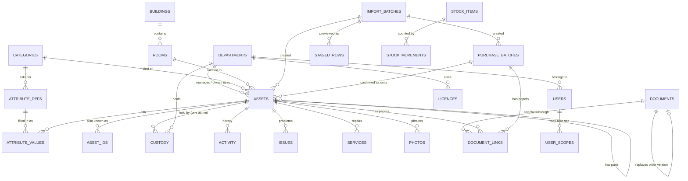

# Entity relationship diagram

How the main records connect. Field-level detail is in `DATA_DICTIONARY.md`. The diagram renders on GitHub.

## Reading it

- **Asset** is one individually tracked thing. Its tag is permanent and comes from a counter that only goes up (`counters`), so it is never reused, even after archiving or a correction (the old tag is kept in `asset_ids`).
- **Custody** answers "who holds it". Exactly one row per asset is open at a time; moving an asset closes one row and opens the next in one step.
- **Lifecycle stage, condition, verification** are separate fields on the asset. The old one-word status is worked out from them.
- A purchase is not an asset. A row such as "20 computers" is a **purchase batch** until units are confirmed; each confirmed unit becomes its own asset.
- Everything that arrives from a file passes through **import batch, staged rows and approval** first, and keeps a link back to its source row.
